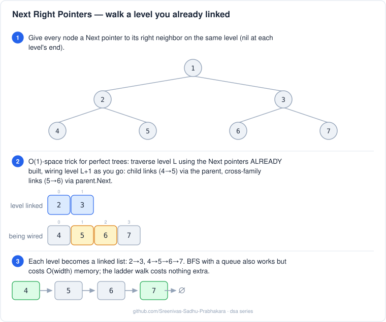

# Populate Next Right Pointers

> Striver SDE Sheet 131 · Day 20 BST — each wired level is a free linked list for walking and wiring the next; no queue needed in a perfect tree. Go, stdlib only, tested.

## Problem

In a perfect binary tree whose nodes carry an extra `Next` pointer, point every node at its right neighbor on the same level (nil for the rightmost). The O(1)-space constraint rules out the obvious level-order queue.

## Approach

Bootstrap: once a level is fully wired, it *is* a linked list — traverse it via `Next` and wire its children. Two link kinds cover everything: siblings (`n.Left.Next = n.Right`, inside one parent) and cousins (`n.Right.Next = n.Next.Left`, hopping the gap between parents through the parent's own Next). Descend via `leftmost.Left` when a level is done. Perfection of the tree is what guarantees `n.Next.Left` exists; the general-tree version (LC 117) keeps the idea but needs a dummy-headed scan to skip missing children.

**Complexity:** O(n) time, O(1) space.

## Visual walkthrough

Read the picture top to bottom — each numbered frame is one moment of the algorithm
running on this repo's test example.

## Run

    go test ./...   # verify
    go run .        # demo

---

One of 191 repos solving Striver's SDE Sheet in Go — stdlib only, one problem per repo, every solution tested. Browse the set: [`dsa-*` repos](https://github.com/Sreenivas-Sadhu-Prabhakara?tab=repositories&q=dsa-&type=source).
